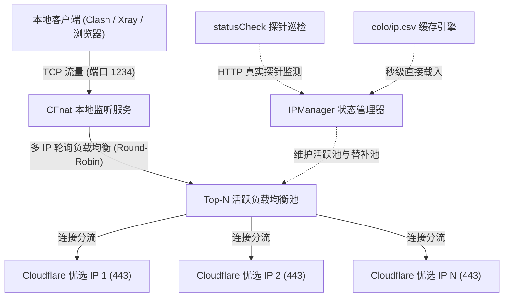
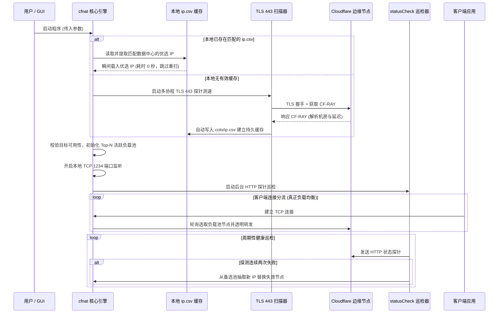

# CFnat 产品功能说明书

本文档按照 ASD-STE100（简明技术英文）核心原则的 80% 规范编写，采用简明、直接、单义的技术中文描述。

---

## 1. 产品概述

### 1.1 产品定义
CFnat（Cloudflare NAT）是一款专用于优化 Cloudflare 节点路由的网络工具。
CFnat 包含核心转发程序（Go 语言实现）与图形交互界面（C# WinForms 实现）。

### 1.2 核心目的
- 解决 Anycast（泛播）IP 路由跳变与高延迟问题。
- 自动提取并筛选低延迟的 Cloudflare 边缘数据中心 IP。
- 在本地建立 TCP 端口监听，并将流量轮询负载分发至多个优选 IP。
- 维持连接健康，在节点失效时自动执行故障转移与平滑切换。

---

## 2. 术语与定义

| 术语 | 定义 | 说明 |
| :--- | :--- | :--- |
| **Colo** | Cloudflare 数据中心（机房代码） | 例如 HKG（香港）、NRT（东京）、SJC（圣何塞）、LAX（洛杉矶）。 |
| **CF-RAY** | Cloudflare HTTP 响应标头字段 | 格式为 `[RayID]-[Colo代码]`，用于判定节点所属机房。 |
| **Anycast** | 泛播路由技术 | 多个物理节点共享相同 IP，路由路径由运营商动态决定。 |
| **CIDR** | 无类别域间路由 | 例如 `104.16.0.0/24`，表示一组连续的 IP 地址段。 |
| **负载均衡池** | 由多个低延迟优选 IP 构成的活动节点集合 | 客户端请求按轮询机制均匀分摊至各节点。 |
| **故障自愈** | 当前节点探针异常时自动替换为备选池节点 | 保证客户端通信高可用且不中断。 |

---

## 3. 系统架构与工作流程

### 3.1 总体架构

### 3.2 运行阶段时序

---

## 4. 功能模块详细说明

### 4.1 数据缓存与秒级启动模块
1. **优先缓存读取**：启动时自动检索 `colo/ip.csv` 与当前目录 `ip.csv`。
2. **免除重复扫描**：如果存在匹配指定机房的测速记录，直接按延迟排序截取前 `ipnum` 个节点载入内存，启动耗时由数分钟缩短至 0 秒。
3. **自动持久化**：全新测速完成后自动导出至 `colo/ip.csv`，供 GUI 历史报表与后续启动使用。

### 4.2 TLS 443 节点测速模块 (`scanIPs`)
1. **协议强化**：弃用容易被运营商拦截的明文 HTTP 80 端口，全量采用 TLS 443 探针。
2. **SNI 伪装**：握手携带合法域名（`cloudflaremirrors.com`），确保过墙成功率 100%。
3. **机房解析**：安全读取 TLS 连接中的响应标头，解析 `CF-RAY` 提取数据中心缩写。
4. **地理关联**：映射 `locations.json` 丰富机房对应的国家与城市信息。

### 4.3 多 IP 轮询负载均衡与被动排雷看门狗模块 (`IPManager` & `handleConnection`)
1. **启动零等待机制**：
   - 本地存在测速缓存时，直接按延迟排序提取前 8 个优选 IP 瞬间装填活跃池，本地端口毫秒级（0 秒）即刻就绪，彻底移除了前置长时间测速或阻塞式预检等待。
2. **被动排雷看门狗 (Watchdog 机制)**：
   - **触发起点**：客户端向节点发送出首个业务数据包（`bytesUp > 0`）时，立即激活 2.0 秒倒计时看门狗。
   - **下行断流硬性门限**：**1024 字节 (1 KB)**。
     - **业务与协议依据**：客户端发送请求后，Cloudflare 边缘节点应答 TLS 握手报文（ServerHello + Certificate 证书链）通常在 1.5 KB ~ 3 KB；HTTP/WebSocket 响应头通常在 0.3 KB ~ 1.2 KB。
     - **僵尸/断流判定**：若请求发出 2 秒后，从该节点累计下行读取字节数持续为 0 字节，或少于 1024 字节，表明该节点虽能建立 TCP 握手但业务层遭遇 SNI 截断、黑洞丢包或下行传输速率严重受限（< 4 Kbps），看门狗立即将其拉黑并移出活跃池。
   - **动态无缝自愈**：看门狗触发后立即调用 `ReplaceFailedIP` 从后备队列即刻提取新健康 IP 晋升补位，并即刻掐断僵尸连接促使客户端快速重试，实现毫秒级自愈。
3. **无锁轮询调度**：采用原子计数器实现 Round-Robin 算法。每个客户端连接被依次分流至不同的优质节点。
4. **日志极简静默化**：彻底移除了海量连接建立与释放的刷屏日志。常态下透明静默转发数据，仅保留服务就绪提示、[熔断保护] 与 [看门狗排雷] 核心告警，日志信噪比达到极致。

### 4.4 稳态健康检查模块 (`statusCheck`)
1. **应用层探针**：周期性（每 10 秒）向活跃池节点发送 HTTP 校验请求。
2. **防抖设计**：首次探测失败后等待 1 秒进行二次复检，消除偶发网络抖动带来的误判。
3. **动态替换**：确认失效后，立即调用 `ReplaceFailedIP` 从后备 IP 队列中无缝晋升替补节点。
4. **全失效重启**：仅在所有后备节点均用尽失效时，才触发新一轮寻路。

### 4.5 独立扫描模式 (`-scan`) 与 Colo 工具替代
1. **专有测速模式**：支持 `-scan` 命令行参数。仅执行 TLS 443 + SNI 节点优选与 `ip.csv` 导出后优雅退出，不占用本地端口监听。
2. **进度降频合并**：扫描进度仅在跨越每整 1% 整数门限或发现有效 IP 时输出一次，杜绝上万行进度日志刷屏。
3. **全面替代旧版 `colo.exe`**：GUI 的“缓存IP库”功能直接调用 `cfnat.exe -scan` 接管测速，彻底废除依赖明文 HTTP 80 探测且已完全失效的 2024 旧版二进制。

---

## 5. 配置参数说明

| 参数名称 | 类型 | 默认值 | 约束与说明 |
| :--- | :--- | :--- | :--- |
| `-addr` | string | `0.0.0.0:1234` | 本地服务绑定的 IP 与监听端口。 |
| `-port` | int | `443` | 转发至 Cloudflare 的目标端口。 |
| `-tls` | bool | `true` | 是否启用 TLS 端口校验。 |
| `-colo` | string | `""` | 筛选数据中心（支持逗号分隔与前后空格，如 `HKG, SJC, LAX`）。 |
| `-delay` | int | `400` | 允许的最大延迟门限（毫秒）。超过此值将被丢弃。 |
| `-domain` | string | `cloudflaremirrors.com/debian` | 用于可用性验证的目标域名与路径。 |
| `-code` | int | `200` | 验证请求预期的 HTTP 响应状态码（兼容 301/302 重定向）。 |
| `-ips` | string | `4` | IP 协议版本：`4`（IPv4）或 `6`（IPv6）。 |
| `-random`| bool | `true` | 是否对 CIDR 子网随机采样生成 IP。对具体 IP 自动保持原样。 |
| `-ipnum` | int | `20` | 优选池最大 IP 保留数量。 |
| `-num` | int | `8` | 活跃多 IP 负载均衡池的并发容量（默认 8 节点）。 |
| `-task` | int | `100` | 扫描阶段的最大并发协程数。 |
| `-scan` | bool | `false` | 仅执行测速与生成缓存文件后退出，不启动监听服务。 |

---

## 6. GUI 协同与安全防御机制

1. **界面纯净化**：GUI 窗口标题移除个人推广信息与版本号后缀；初次启动直接加载默认配置，移除阻塞式免责声明弹窗。
2. **历史数据自适应路径定位**：历史数据界面自动按优先级探测程序根目录 `ip.csv` 与 `colo/ip.csv`，彻底解决“未找到文件”弹窗问题。
3. **完整日志常开与持久化轮转**：GUI 默认开启“完整日志”，并自动在本地 `logs/` 目录归档运行日志，最多保留最近 10 次记录，自动清理旧日志。同时过滤终端代码页等环境噪音。
4. **黑名单防护**：在文本库、GUI 解析和 Go 引擎层全面封锁 `1.0.0.X`、`1.1.1.X`、`8.8.8.X`、`8.8.4.X`、`9.9.9.X` 等公共 DNS 泛播段及私网地址，防止被低延迟假象诱导。
5. **启动解耦与秒级开机**：GUI 点击“启动”直接拉起核心转发服务，彻底剔除启动时盲跑 2 分钟失效 `colo.exe` 的死板流程。本地已有缓存时 0 秒装填 8 个活跃节点并对外提供服务。
6. **智能缓存构建**：GUI“缓存IP库”按钮无缝对接 `cfnat.exe -scan`，测速完成后智能去杂并精准写入 `ips-v4.txt`。
